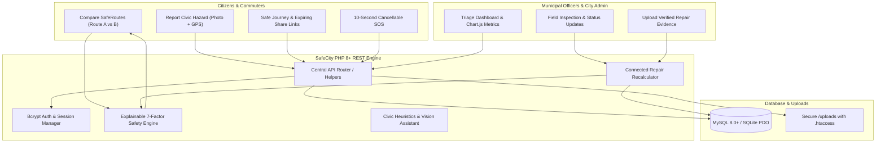

# SafeCity AI — Smart Civic Intelligence & Safer Routes

> **An advanced, explainable smart-city platform combining visual civic complaint management with HERGUARD-style intelligent personal safety navigation.**

[](https://php.net)
[](https://mysql.com)
[](https://leafletjs.com)
[](https://chartjs.org)
[](LICENSE)

---

## 1. Executive Summary & Vision

**SafeCity AI** addresses two deeply interconnected civic challenges:
1. **Citizens encounter severe infrastructure hazards** (unlit blacked-out roads, dangerous asphalt potholes, open stormwater manholes) that create immediate physical and personal safety vulnerabilities.
2. **Pedestrians and night commuters lack transparent safety data**, often forced to make travel decisions blindly without knowing which streets have active hazards, working streetlights, or nearby help points.

### The SafeCity Solution: The Connected Civic Feedback Loop
SafeCity AI links civic repair workflows directly to navigation safety:
- When a citizen reports a hazard (e.g. 3 consecutive broken streetlights), the road segment is penalized.
- When an authorized municipal officer verifies the repair with after-repair photographic evidence, the road segment's lighting or pavement score is recalculated.
- Corridor safety scores update dynamically with a transparent, audited change notice:
  > *"Road condition data updated following an officer-reviewed repair record."*

---

## 2. System Architecture



---

## 3. Technology Stack

- **Frontend:**
  - Modern HTML5 with Semantic Accessibility
  - Modern CSS3 with Design System Tokens (Dark Navy `#0a0f1d`, Teal `#0d9488`, Cyan `#06b6d4`, Blue `#3b82f6`)
  - Vanilla JavaScript (ES6+ Modular Architecture)
  - **Leaflet.js & OpenStreetMap** for interactive maps and route polylines
  - **Chart.js** for real-time category distribution analytics
  - Font Awesome 6 Icons
- **Backend:**
  - **PHP 8.3+** with strict typing and JSON REST endpoints
  - **PHP PDO** database abstraction layer
  - Secure Sessions (`httponly`, `SameSite=Lax`, Session ID regeneration)
  - Cryptographically secure upload handling with MIME-type verification
- **Database:**
  - **MySQL 8.0+ / MariaDB 10.4+** (Standard XAMPP production target)
  - **SQLite Dual-Mode Fallback:** If MySQL is not running, SafeCity automatically initialises and connects to `safecity.sqlite` with seed data, ensuring zero setup friction!
- **Development Tools:**
  - Visual Studio Code, XAMPP, Git & GitHub

---

## 4. Pre-Configured Demo Accounts

For local evaluation, hackathon judging, and academic defense:

| Role | Email Address | Password | Privileges |
| :--- | :--- | :--- | :--- |
| **Citizen** | `citizen@safecity.org` | `password123` | File complaints, track issues, SafeRoute, rate roads, active journey |
| **Officer** | `officer@safecity.org` | `password123` | Review tickets, update status, upload repair evidence, trigger recalculations |
| **Admin** | `admin@safecity.org` | `password123` | Full administrative and audit inspection access |

> **Note:** The login page features **1-click Quick-Fill buttons** for rapid testing without manual typing.

---

## 5. Transparent 7-Factor Safety Engine

The prototype uses a documented, explainable rule-based scoring engine. Every corridor is evaluated on a normalized scale from **0 to 100**:

$$\text{Safety Score} = \sum (F_i \times W_i)$$

$$\begin{aligned}
\text{Safety Score} = & \;(\text{Lighting} \times 0.20) + (\text{Crowd Activity} \times 0.15) \\
& + (\text{Incident History} \times 0.25) + (\text{Help Point Access} \times 0.15) \\
& + (\text{Time-Related Factor} \times 0.10) + (\text{Road Condition} \times 0.10) \\
& + (\text{Community Signal} \times 0.05)
\end{aligned}$$

### Weight Distribution & Justification:

| Factor | Weight | Justification |
| :--- | :---: | :--- |
| **Incident-History Signal** | **25%** | Historical frequency of verified civic and emergency reports along corridor. |
| **Lighting Quality** | **20%** | Streetlight illumination fixtures, operational status, and absence of dark blackout spans. |
| **Crowd Activity** | **15%** | Natural surveillance from open commercial shops, transit stations, and pedestrian density. |
| **Proximity to Help Points**| **15%** | Distance buffer to police stations, 24/7 hospitals, women safety kiosks, and help booths. |
| **Time-Related Factor** | **10%** | Heuristic temporal adjustment (daylight commute vs late-night corridor isolation). |
| **Road Condition** | **10%** | Pavement smoothness, sidewalk integrity, and absence of open hazardous potholes. |
| **Community Signal** | **5%** | Moderated citizen star ratings and localized community safety reports. |

> **Honest Disclaimer:** Scores represent relative reported infrastructure conditions in this prototype corridor. The engine does **not** predict criminality, profile individuals, or guarantee absolute safety.

---

## 6. Project File Structure

```text
safecity/
├── index.html               # Home / Landing page with hero, stats, & preview map
├── login.html               # Login page with demo quick-fill buttons
├── signup.html              # Citizen registration with validation
├── dashboard.html           # Citizen dashboard with personal reports table
├── report.html              # Report problem with Leaflet picker & AI assistant
├── track.html               # Public complaint tracking with 3-step timeline
├── officer-dashboard.html   # Municipal officer console with Chart.js & repair upload
├── route.html               # SafeRoute two-route comparison engine
├── heatmap.html             # Safety heatmap with multi-category layers
├── journey.html             # Safe Journey monitor with live elapsed timer
├── shared-journey.html      # Privacy-preserving view for trusted contacts
├── sos.html                 # 10-second countdown SOS with India helplines
├── rate.html                # Road ratings form and community reviews
├── places.html              # Nearby safe places directory with distance sorting
├── profile.html             # User profile and emergency contact settings
├── about.html               # Methodology, formulas, security, & disclaimer
│
├── css/
│   ├── style.css            # Dark navy design system tokens, typography, cards
│   ├── components.css       # Buttons, forms, modals, toasts, timelines, SOS ring
│   └── responsive.css       # Breakpoints for mobile, tablet, and desktop
│
├── js/
│   ├── api.js               # Central Fetch API wrapper with CSRF injection
│   ├── auth.js              # Session manager, role authorization guards
│   ├── app.js               # Global UI utilities, toasts, modals, formatting
│   ├── map.js               # Leaflet map manager, custom SVG markers
│   ├── report.js            # Complaint reporting, map picker, AI assistant
│   ├── tracking.js          # Complaint lookup, timeline rendering, evidence
│   ├── dashboard.js         # Citizen & Officer dashboards, Chart.js graphs
│   ├── route.js             # SafeRoute comparison, polyline drawer, factor bars
│   ├── safety-score.js      # 7-factor weighted formula explainability engine
│   ├── journey.js           # Journey start/stop, share token generation
│   ├── sos.js               # 10s countdown, audio chime, alert persistence
│   ├── ratings.js           # Star rating widgets and community review feed
│   ├── places.js            # Safe places search and distance calculations
│   └── heatmap.js           # Heatmap layer groups and cluster halos
│
├── php/
│   ├── config.php           # Active environment configuration
│   ├── config.example.php   # Configuration template
│   ├── db.php               # PDO database manager (MySQL + SQLite dual-mode)
│   ├── helpers.php          # JSON responses, CSRF, uploads, priority scoring
│   ├── auth.php             # Role-based middleware (requireOfficer, requireAdmin)
│   ├── signup.php           # User signup endpoint
│   ├── login.php            # User login endpoint
│   ├── logout.php           # Session destruction endpoint
│   ├── me.php               # Current session & CSRF token endpoint
│   ├── save_complaint.php   # File upload, priority calculation, segment linkage
│   ├── get_complaints.php   # Filterable complaint list with role privacy
│   ├── get_complaint.php    # Single complaint detailed view
│   ├── get_status.php       # Public tracking endpoint (strictly scrubbed)
│   ├── update_status.php    # Officer status update + repair recalculation trigger!
│   ├── get_routes.php       # Two-route comparison and factor aggregation
│   ├── get_places.php       # Safe places directory with distance calculations
│   ├── save_rating.php      # Road rating submission with abuse prevention
│   ├── get_ratings.php      # Road ratings and statistical aggregation
│   ├── save_journey.php     # Journey initialization & expiring token generation
│   ├── update_journey.php   # Journey completion / cancellation
│   ├── get_shared_journey.php # Privacy-safe view for trusted contact
│   ├── revoke_journey_share.php # Share token revocation
│   ├── save_sos.php         # SOS alert persistence & rate limiting
│   ├── get_dashboard_stats.php # Real-time metrics and category counts
│   └── ai_assist.php        # AI/Heuristic civic complaint assistant
│
├── sql/
│   ├── schema.sql           # MySQL database schema with foreign keys
│   ├── schema_sqlite.sql    # SQLite database schema for portable execution
│   └── seed.sql             # Demonstration seed data (routes, users, complaints)
│
├── uploads/
│   ├── .htaccess            # Security: blocks script execution in uploads
│   ├── complaints/          # Citizen problem photo storage
│   └── repairs/             # Officer verified repair evidence storage
│
├── assets/                  # Demonstration civic asset photos with geotags
├── tests/
│   └── test_api.php         # Automated CLI test suite covering all 12 criteria
└── README.md
```

---

## 7. Quick Start & Setup Instructions

### Option A: Instant Zero-Config (Using Built-in PHP Server)
Because SafeCity AI includes an automatic SQLite portable engine, you can launch the complete application with real database reads, writes, and recalculations instantly without installing or configuring MySQL:

1. Open PowerShell / Command Prompt in the `safecity` directory:
   ```powershell
   cd safecity
   ```
2. Start the PHP built-in web server:
   ```powershell
   php -S localhost:8000
   ```
3. Open your browser and navigate to:
   ```text
   http://localhost:8000
   ```

### Option B: XAMPP / Apache / MySQL Setup
1. Copy the `safecity` folder into your XAMPP web root:
   ```text
   C:\xampp\htdocs\safecity
   ```
2. Start **Apache** and **MySQL** in the XAMPP Control Panel.
3. Open **phpMyAdmin** (`http://localhost/phpmyadmin`).
4. Create a new database named `safecity`.
5. Import `sql/schema.sql`, then import `sql/seed.sql`.
6. Verify `php/config.php` has:
   ```php
   define('DB_DRIVER', 'mysql');
   define('DB_HOST', '127.0.0.1');
   define('DB_PORT', 3306);
   define('DB_NAME', 'safecity');
   define('DB_USER', 'root');
   define('DB_PASS', '');
   ```
7. Open in browser: `http://localhost/safecity`.

---

## 8. Verification & Automated Test Suite

To verify all 12 acceptance criteria programmatically, run the automated test suite from the CLI:

```powershell
php tests/test_api.php
```

### Verified Acceptance Criteria:
- **Test 1:** Citizen registration, bcrypt password hashing, and complaint filing with unique code.
- **Test 2:** Public tracking endpoint returns status timeline without exposing private emails.
- **Test 3:** Officer status update to "In Progress" persisted in DB with audit trail.
- **Test 4:** Signature Feature: Verified streetlight repair recalculates corridor lighting score from 45 to 80!
- **Test 5:** SafeRoute two-route comparison with 7 factors summing exactly to 100%.
- **Test 6:** Heatmap coordinates and marker integrity.
- **Test 7:** Safe Journey lifecycle with secure 3-hour expiring share tokens and revocation.
- **Test 8:** SOS alert persistence in database and India emergency numbers.
- **Test 9:** Road rating submission with aggregate rating calculations.
- **Test 10:** Safe places directory with distance calculation.
- **Test 11:** Role-based authorization: citizens blocked from officer endpoints.
- **Test 12:** Input validation, XSS escaping, and safe error handling.

---

## 9. 3-Minute Hackathon / College Presentation Script

Use this sequence during live demonstrations:

| Minute | Action / Screen | Talking Point |
| :---: | :--- | :--- |
| **0:00 - 0:30** | **Home (`index.html`)** | *"Welcome to SafeCity AI. We solve the disconnect between municipal repair delays and personal commuter safety through an explainable, data-backed feedback loop."* Highlight live stats and the two primary CTAs. |
| **0:30 - 1:00** | **Citizen Report (`report.html`)** | Click "Report Issue". Click the map to drop a pin. Pick severity 4. Click **"AI Assistant"** to show rule-based heuristic category analysis. Submit and reveal the tracking code (e.g. `SC-2026-1002`). |
| **1:00 - 1:45** | **Officer Console (`officer-dashboard.html`)** | Sign in as Demo Officer. Show Chart.js distribution. Open complaint `SC-2026-1002` (Broken Streetlight). Upload repair photo and set status to **"Fixed"**. Save! Show the signature alert: *"Road condition data updated following an officer-reviewed repair record."* |
| **1:45 - 2:15** | **SafeRoute (`route.html`)** | Open SafeRoute. Compare Route A vs Route B. Show how Route B's lighting factor jumped following our verified repair! Explain the transparent 7-factor weights breakdown. |
| **2:15 - 2:40** | **Safe Journey & SOS (`journey.html` & `sos.html`)** | Click "Start Safe Journey". Show the live timer and the secure 3-hour expiring share link for family. Open SOS: press the giant button, show the 10-second countdown with audio beep, hit "Cancel" to demonstrate false-alarm handling, and display official India helplines (112, 100, 1091). |
| **2:40 - 3:00** | **Conclusion & Ethics (`about.html`)** | Conclude with our transparent disclaimer: *"SafeCity AI provides explainable infrastructure indicators, not black-box crime predictions. It creates measurable civic ROI for smart cities."* |

---

## 10. Honest Disclaimers & Production Roadmap

1. **Safety Prototype Status:** Safety scores reflect relative reported municipal infrastructure conditions and illumination. They do not predict crime or guarantee personal safety.
2. **Emergency Gateway:** The SOS interface logs alerts to the database with geocoordinates for demonstration. External SMS dispatch gateways (e.g. Twilio/MSG91) and CAD police dispatch require certified municipal infrastructure integration.
3. **Emergency Services:** In any real-world emergency, citizens should immediately dial **112** (India National Emergency) or **100** (Police).

---
*Developed for College Showcase, Hackathons, and Open Source Civic Tech Innovation.*

